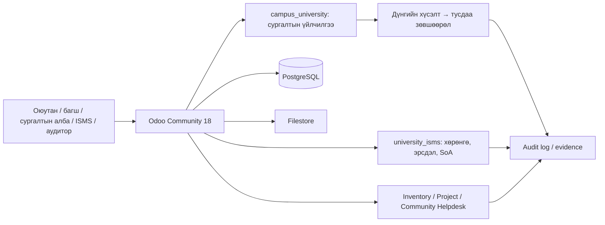

# Архитектур ба өгөгдлийн гэрээ

## Зорилго

Их сургуулийн сургалтын үйлчилгээний өөрчлөлтийг мэдээллийн аюулгүй байдлын засаглалтай холбож бодит Odoo Community орчинд ажиллуулна. Бүх өгөгдөл зохиомол.

## Хуваах зарчим

- `campus_university` (Codex): `base`, `mail`-д тулгуурлана. Сургалтын мэдээллийн домэйн.
- `university_isms` (Deployment агент): asset/risk/control/policy/incident домэйн; Community Helpdesk, Inventory, audit-тай холбох.
- Хоорондын dependency cycle үүсгэхгүй. ISMS module нь шаардлагатай үед `campus_university`-г depend хийнэ эсвэл bridge extension ашиглана.
- OpenCode dataset нь эхлээд JSON/CSV; XML ID нь тогтвортой, import нь idempotent байна.

## Academic model contract v1 (Codex эзэмшил)

| Model | Гол талбар | Шалгуур |
|---|---|---|
| `campus.program` | code, name, department, owner_id | code unique |
| `campus.student` | student_code, name, user_id, program_id, institutional_email, status | student_code unique; user_id unique; зөвхөн зохиомол сургууль доторх email |
| `campus.course` | code, name, credits, program_id | code unique; 1–6 кредит |
| `campus.offering` | name, course_id, semester, lecturer_id, state | тухайн багшид хуваарилагдсан санал; draft/open/locked |
| `campus.enrollment` | student_id, offering_id, score, grade_revision | (student, offering) unique; score 0–100; оноог шууд write хориглоно |
| `campus.grade.change` | enrollment_id, old_score, old_revision, proposed_score, reason, requester_id, state, approver_id, approved_at | draft/submitted/approved/rejected; requester≠approver; stale revision reject |

## Academic workflow

`Багш/Сургалтын алба draft хүсэлт` → `Submit` → `Өөр эрх бүхий сургалтын албаны ажилтан Approve/Reject` → `Approve бол score ба revision нэг transaction-д шинэчлэгдэнэ` → `Audit`.

- public action method бүр server талд эрх болон төлөвөө шалгана. Button visibility бол хамгаалалт биш.
- Actor/state/old_score/old_revision талбарыг RPC write-аар өөрчлөхгүй.
- Student өөрийн бүртгэл/дүнг уншина; бусдыг харахгүй. Lecturer зөвхөн өөрийн offering-ийн enrollment ба student-г уншина. Registrar бүртгэл хөтөлж зөвшөөрөл өгнө. Academic auditor зөвхөн уншина.
- Grade өөрчлөлтийн үндэслэл нь хүний хувийн мэдээлэл агуулахгүй; тайлбарын урт ≥10 тэмдэг.
- `campus_isms_bridge` нь `isms.audit.mixin`-ээр `campus.student`, `campus.enrollment`, `campus.grade.change`-ийг audit-д хамруулсан. OCA auditlog module ашиглаагүй.

## Integration contract

- Хөрөнгийн бүртгэлд `Student Records DB`, `Grade Ledger`, `Lab Equipment`, `Odoo/DB/Backup` орно.
- Grade өөрчлөлтөөс үүдсэн сэжигтэй үйл явдлыг Helpdesk incident ticket-тэй external reference-аар холбоно. Автомат incident үүсгэх бол тусдаа батлагдсан дүрэмтэй байна.
- Хувийн мэдээллийг email/chatter-д бүхэлд нь тараахгүй. Student form-ийн эмзэг талбарыг groups болон record rule-ээр хамгаална.
- Audit UI-ийн унших эрх академик role-оос тусдаа; энгийн хэрэглэгч audit бичлэг засах/устгах эрхгүй.

## Runtime

Одоо байгаа Docker runtime ба cached PostgreSQL image-ийг ашиглах саналтай. Odoo service зөвхөн loopback publish; DB-г host руу publish хийхгүй. DB ба filestore-г хамтад нь backup/restore хийнэ. Deployment-ийн эцсийн version/commit/image digest-г Deployment агент environment note-д тогтооно.

## Бодитоор суусан интеграц (2026-11-16)

- `campus_isms_bridge`: academic → application audit; grade asset/incident reference.
- `university_isms_helpdesk`: ISMS canonical incident ↔ OCA18 helpdesk_mgmt нэг тасалбар/5stage; action context нь зөвхөн5stage харуулна.
- `university_isms_stock` + `university_isms_inventory_catalog`:16asset ↔16product;owner/class/location/risk;5hardware DEMOserial,facility/nonhardware service.
- Deployed Odoo18.0-20261112,PostgreSQL16,Composeisms;loopback8069,DBpublishгүй. Runbookoperations.md.
